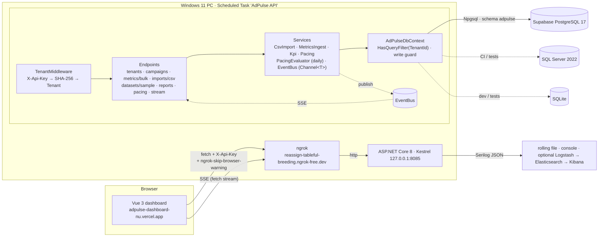

# AdPulse — multi-tenant ad-campaign & budget-pacing API

[](https://github.com/D-L-Narayana/adpulse/actions/workflows/ci.yml)

| | |
|---|---|
| **Dashboard (Vercel)** | https://adpulse-dashboard-nu.vercel.app |
| **API (self-hosted, ngrok)** | https://reassign-tableful-breeding.ngrok-free.dev — Swagger at [`/swagger`](https://reassign-tableful-breeding.ngrok-free.dev/swagger), health at [`/health`](https://reassign-tableful-breeding.ngrok-free.dev/health) |
| **Database** | PostgreSQL 17 on Supabase, schema `adpulse` (SQL Server 2022 and SQLite are first-class too — same model, same tests) |

AdPulse is the service behind an "advertising cloud" dashboard. A visitor creates a **workspace** (name + email, no
password) and gets an API key once. Everything they push — Google Ads / Meta Ads Manager CSV exports, bulk REST
metrics, or an explicitly requested public sample dataset — lands in **their** tenant only, is aggregated into
server-side KPIs (CTR, CPC, CPA, ROAS) and is watched by a **budget-pacing engine** that says, today, whether a
campaign will over- or under-spend its flight and what the corrected daily budget should be. Changes are pushed to
the dashboard over **Server-Sent Events**. There is no demo mode and no bundled fake data.

| Layer | Tech |
|---|---|
| API | C# 12 · ASP.NET Core 8 minimal API · EF Core 8 · Serilog · Swashbuckle |
| Databases | **MS SQL Server 2022** (CI + tests) · **PostgreSQL** via Npgsql (production, Supabase, `HasDefaultSchema("adpulse")`) · SQLite (dev + fast tests). Selected by `Database:Provider`; per-provider EF migrations. |
| Tenancy | `X-Api-Key` → SHA-256 lookup → scoped `TenantContext` → EF global query filters on `TenantId` + `SaveChanges` write guard |
| Live | `GET /api/v1/stream` SSE, one bounded `Channel<T>` per subscriber, 15 s heartbeat; daily pacing evaluation emits `pacing.alert` |
| Tests | xUnit + `WebApplicationFactory` (**136** tests) · Reqnroll BDD (**22** scenarios) · run on SQLite and on a SQL Server 2022 container in CI |
| Hosting | API on a Windows 11 PC (Scheduled Task at logon → Kestrel :8085 + ngrok static domain) · dashboard on Vercel · ELK pipeline via Docker Compose |

---

## Architecture



```
src/AdPulse.Api/
  Program.cs                 wiring: provider selection, CORS, rate limit on signup, Swagger, migrations at start
  Tenancy/                   TenantMiddleware (header or ?api_key= for SSE), TenantContext, ApiKeys (generate / hash / slug)
  Endpoints/                 Tenant · Campaign · Metrics (bulk) · Import (csv) · Dataset (sample) · Report · Pacing · Stream
  Services/                  CsvImport (detect + map), MetricsIngest (single write path), Kpi, Pacing, PacingAlerts, EventBus, CampaignLifecycle
  Data/                      AdPulseDbContext (+ SqlServerDbContext / PostgresDbContext), Migrations/{SqlServer,Postgres}, DbSeeder (tests only)
  Datasets/                  vendored sample dataset + SOURCE.md (license + derivation)
tests/AdPulse.Tests/         xUnit integration tests          tests/AdPulse.Specs/   Reqnroll features + steps
web/                         Vue 3 + Vite dashboard (deployed to Vercel; expects VITE_API_URL)
scripts/                     start-adpulse.ps1, install-adpulse-task.ps1 (hosting) · bench.py, bench.k6.js (latency)
elk/, docker-compose*.yml    Logstash pipeline; compose for api + SQL Server (or Postgres) + ELK
.github/workflows/ci.yml     build → test on SQLite (+ Coverlet) → test on SQL Server 2022 service → docker build → web build
```

---

## API (`/api/v1`)

All routes need `X-Api-Key` except `POST /tenants`, `GET /datasets/sample[/download]`, `/health`, `/swagger`.
Errors are RFC 7807 `application/problem+json` with `type = https://adpulse.dev/errors/<code>` and a `traceId` that
matches the log line.

| Method | Route | Purpose |
|---|---|---|
| POST | `/tenants` | **Create a workspace** `{name,email}` → `201 {id, slug, apiKey, workspacePath}`. The key is returned **once**; only its SHA-256 is stored. 20/min per IP. |
| GET | `/tenants/me` | Tenant behind the key + row counts |
| POST | `/imports/csv?dryRun=true` | multipart `file=` → detected format (`google-ads` / `meta-ads` / `generic`), column mapping, currency, first 10 normalised rows, warnings. Nothing is written. |
| POST | `/imports/csv` | Same file → upserts campaigns + daily metrics, writes an `Import` audit row, emits `import.completed` |
| GET | `/imports`, `/imports/{id}` | Import history |
| POST | `/metrics/bulk` | `{rows:[{campaign|campaignId, channel?, date, impressions, clicks, conversions, spend, revenue}]}` — creates campaigns by name, upserts per day. **`Idempotency-Key` header**: same key + same body → stored response replayed (`Idempotent-Replayed: true`); same key + different body → `422 idempotency_key_reused`. |
| GET | `/datasets/sample` · `/sample/download` | Public metadata/license/attribution and the CSV of the sample dataset |
| POST | `/datasets/sample/import?rebaseDates=` | Import the sample into **your** workspace (never automatic) |
| GET/POST/PUT/DELETE | `/campaigns`, `/campaigns/{id}` | CRUD (tenant-scoped; foreign ids are `404`) |
| GET | `/campaigns/summary?asOf=` | Every campaign + lifetime KPIs + pacing (dashboard table) |
| POST | `/campaigns/{id}/activate|pause|complete` | Lifecycle `Draft → Active ⇄ Paused → Completed` (`409 invalid_transition`, `422 flight_ended`) |
| PUT/GET | `/campaigns/{id}/metrics` | Upsert / read daily rows for one campaign |
| GET | `/campaigns/{id}/kpis`, `/campaigns/{id}/pacing` | Per-campaign KPIs; pacing status + suggested daily budget |
| GET | `/reports/summary?from=&to=` | Window vs previous window vs lifetime KPIs, pacing distribution, last metric date |
| GET | `/reports/cross-channel`, `/reports/daily` | Per-channel KPI rows + total; daily trend |
| POST/GET | `/pacing/evaluate`, `/pacing/alerts` | Run the pacing evaluation now (emits `pacing.alert`) / list current alerts |
| GET | `/stream` | **SSE** `text/event-stream` — see below |
| GET | `/health` (public), `/api/v1/health` | Liveness + DB check; authenticated variant adds provider, event counters, last pacing run |

### Quick start with curl (against the live API)

```bash
API=https://reassign-tableful-breeding.ngrok-free.dev
SKIP='ngrok-skip-browser-warning: 1'       # only needed for browser-like clients, harmless for curl

# 1. workspace
curl -s -X POST $API/api/v1/tenants -H 'content-type: application/json' \
     -d '{"name":"Acme Retail","email":"you@example.com"}'
# → {"slug":"acme-retail","apiKey":"adp_live_…","workspacePath":"/w/acme-retail", …}   (save the key: it is shown once)
KEY=adp_live_…

# 2. push data (idempotent)
curl -s -X POST $API/api/v1/metrics/bulk -H "X-Api-Key: $KEY" -H 'content-type: application/json' \
     -H 'Idempotency-Key: 2026-10-28-google' -d '{"rows":[
       {"campaign":"Brand Search","channel":"GoogleAds","date":"2026-10-27","impressions":12000,"clicks":600,"conversions":30,"spend":450.5,"revenue":2100}]}'

# 3. or import a real export (preview first)
curl -s -X POST "$API/api/v1/imports/csv?dryRun=true" -H "X-Api-Key: $KEY" -F file=@google-ads-export.csv
curl -s -X POST  $API/api/v1/imports/csv              -H "X-Api-Key: $KEY" -F file=@google-ads-export.csv

# 4. read
curl -s $API/api/v1/reports/summary        -H "X-Api-Key: $KEY"
curl -s $API/api/v1/campaigns/summary      -H "X-Api-Key: $KEY"

# 5. live
curl -sN $API/api/v1/stream -H "X-Api-Key: $KEY"
```

### Live stream (SSE)

```
GET /api/v1/stream            X-Api-Key header, or ?api_key=… (EventSource cannot set headers)

: connected tenant=acme-retail
retry: 3000
id: 1
event: heartbeat
data: {"type":"heartbeat","atUtc":"…","data":{"tenant":"acme-retail","subscribers":1}}

id: 2
event: metrics.upserted         data.data = {campaignId, rows, from, to}
event: campaign.changed         data.data = {campaignId, name, status, channel, reason: created|updated|deleted|activate|pause|complete|ingest|metrics}
event: import.completed         data.data = the ImportCommitResponse
event: pacing.alert             data.data = {campaignId, campaign, pacingPercent, status: over|under, suggestedDailyBudget, message}
```

`EventBus` keeps one bounded `Channel<ServerEvent>` (256, drop-oldest) per subscriber, grouped by tenant; publishing
never blocks a request. A heartbeat is sent every 15 s so proxies keep the connection open. It is a single-process
bus by design — swap in Redis pub/sub if the API ever runs on more than one node.

**ngrok caveat (free tier):** requests whose `User-Agent` looks like a browser get an HTML/plain-text interstitial
unless they carry the header `ngrok-skip-browser-warning` (any value). The dashboard therefore sends that header on
every call **and consumes the SSE stream with `fetch()` + `ReadableStream` instead of `EventSource`** (which cannot set
headers). The API's CORS policy allows that header, `X-Api-Key` and `Idempotency-Key` for `https://adpulse-dashboard-nu.vercel.app`
and `http://localhost:5173`.

---

## Tenancy

```
POST /api/v1/tenants ─► key = "adp_live_" + 32 random bytes (base64url)
                        Tenants row: Slug (unique), Email, ApiKeyHash = SHA-256(key), ApiKeyPrefix (12 chars for display)
                        → response carries the key exactly once

request ─► TenantMiddleware (/api/* except public routes)
            │  key  = X-Api-Key header   (or ?api_key= on /api/v1/stream only)
            │  tenant = Tenants.Single(t => t.ApiKeyHash == SHA256(key))     -- unique index
            │  TenantContext.Set(tenant); LogContext.PushProperty("TenantId", …)
            ▼
         endpoint ─► AdPulseDbContext(options, TenantContext)
                       any query on Campaign / DailyMetric / Import / IdempotencyRecord  =>  … AND TenantId = @tenant   (HasQueryFilter)
                       Add(entity)                      =>  TenantId stamped in SaveChangesAsync
                       Modify / Delete foreign row      =>  InvalidOperationException("Cross-tenant write rejected.")
```

* Foreign resources are indistinguishable from missing ones (`404`, never `403`).
* Uniqueness is per tenant: `(TenantId, Name)` campaigns, `(CampaignId, Date)` metrics, `(TenantId, Key)` idempotency keys.
* Cross-tenant reads only happen with an explicit `IgnoreQueryFilters()` (the daily pacing job iterates tenants and
  evaluates each one under its own `TenantContext` instead).
* `TenantIsolationTests`: 20 hostile probes × 2 attacker profiles = **40 cases**, plus signup / import / stream
  isolation tests. Demo tenants and fixed demo keys exist **only** in the test/benchmark seeder (`Seed:Enabled=true`);
  production starts empty.

---

## CSV import formats

Detection is header-based (`Services/CsvImport.cs`), the mapping is returned by the dry run so the UI can show it
before anything is written. Segmented rows (device, age, gender, …) are summed into one row per campaign-day.

| Format | How it is recognised | Columns used |
|---|---|---|
| **Google Ads** (Reports → Download → CSV) | `Campaign` + `Cost`/`Conv.`/`Impr.` + `Day`/`Date`; title lines before the header and trailing `Total: …` rows are skipped | `Campaign`, `Day`, `Cost` (thousands separators OK), `Impressions`, `Clicks`, `Conversions`, `Conv. value` (→ revenue) |
| **Meta Ads Manager** (Export → CSV) | `Campaign name` + `Amount spent (XXX)` / `Link clicks` / `Results` / `Reporting starts` | `Campaign name`, `Day`, `Amount spent (INR)` (currency read from header), `Impressions`, `Link clicks`, `Results`, `Purchases conversion value` |
| **Generic template** | anything else with a campaign and a date column | `campaign, date, impressions, clicks, conversions, spend, revenue[, channel]` — synonyms accepted (`cost`, `spent`, `purchases`, `platform`, …); `,` `;` or tab delimited; dates `yyyy-MM-dd`, `dd/MM/yyyy`, `MM/dd/yyyy`, … |

Campaigns named in a file are created on first sight (channel from the format or the `channel` column; flight =
min date → max date or today + 13 days; daily budget = average daily spend; data older than 30 days is stored as a
`Completed` flight). Re-importing the same file updates rather than duplicates. Each commit writes an `Import`
row (`source`, counts, warnings) visible at `GET /api/v1/imports`.

### Sample dataset (opt-in, attributed)

`GET /api/v1/datasets/sample` serves the **Facebook Ad Campaign** dataset published on Kaggle by Madis Lemsalu
(courtesy of Bunq) under the **ODC Public Domain Dedication and Licence (PDDL)** — real 2017 paid-social data,
1,143 ad-day rows, 3 campaigns, aggregated to 35 campaign-days. The raw file, the derived CSV and the exact derivation
are in [`src/AdPulse.Api/Datasets/SOURCE.md`](src/AdPulse.Api/Datasets/SOURCE.md). It has no revenue column, so
ROAS is 0 — we do not invent numbers. It is imported only when a user asks (`POST /datasets/sample/import`,
optionally `?rebaseDates=true` to end the 14-day window today) and is labelled `sample-dataset` in the import audit.

---

## Pacing

`Services/Pacing.cs` is a pure function (unit-tested for thresholds, clamping, division by zero):

```
daysTotal   = EndDate − StartDate + 1          daysElapsed = clamp(asOf − StartDate + 1, 0, daysTotal)
expected    = DailyBudget × daysElapsed        pacing%     = actual / expected × 100
status      = not-started | under (< 90 %) | on-track | over (> 110 %)
suggested   = max(0, DailyBudget × daysTotal − actual) / (daysTotal − daysElapsed)
```

`PacingEvaluator` applies it to every Active campaign of a tenant and raises a **`pacing.alert` when the campaign is
more than 15 % over or under pace**. `PacingAlertService` (a `BackgroundService`) runs it for every tenant once a
day (`Pacing:EvaluationInterval`, first run `Pacing:InitialDelay` after start); `POST /api/v1/pacing/evaluate` runs
it on demand for the caller.

---

## Databases & migrations

`Database:Provider` picks the EF Core provider; the model is identical, only the migrations differ.

| Provider | Used for | Schema | Migrations |
|---|---|---|---|
| `SqlServer` | CI (service container), local Docker Compose, tests with `ADPULSE_TEST_PROVIDER=SqlServer` | `dbo` | `src/AdPulse.Api/Migrations/SqlServer` (`SqlServerDbContext`) |
| `Postgres` | Production — Supabase, shared project, everything in schema **`adpulse`** (`HasDefaultSchema`, history table `adpulse.__EFMigrationsHistory`) | `adpulse` | `src/AdPulse.Api/Migrations/Postgres` (`PostgresDbContext`) |
| `Sqlite` | `dotnet run` with no config, in-memory per test class | — | none (`EnsureCreated`) |

Migrations are applied at startup (`MigrateAsync`) for SQL Server / Postgres. To add one:

```bash
cd src/AdPulse.Api
dotnet ef migrations add <Name> --context PostgresDbContext  -o Migrations/Postgres
dotnet ef migrations add <Name> --context SqlServerDbContext -o Migrations/SqlServer
# apply to Supabase from a shell that has the connection string (session pooler, port 5432):
ADPULSE_POSTGRES="Host=aws-0-ap-south-1.pooler.supabase.com;Port=5432;Database=postgres;Username=postgres.<ref>;Password=…;SSL Mode=Require;Trust Server Certificate=true" \
  dotnet ef database update --context PostgresDbContext
```

---

## Configuration

Environment variables override `appsettings*.json` (`__` = `:`).

| Key | Default | Meaning |
|---|---|---|
| `Database__Provider` | `Sqlite` | `SqlServer` \| `Postgres` \| `Sqlite` |
| `ConnectionStrings__Default` | `Data Source=adpulse.db` | provider connection string |
| `Database__SkipInit` | `false` | skip migrations/EnsureCreated at start |
| `Seed__Enabled`, `Seed__TenantCount` | `false`, `500` | test/benchmark fixture (2 demo + N synthetic tenants). Never enable in production. |
| `Cors__Origins__0…` | localhost:5173/4173 + Vercel URL | allowed browser origins |
| `RateLimiting__SignupPerMinute` | `20` | signups per minute per IP |
| `Pacing__Enabled`, `Pacing__EvaluationInterval`, `Pacing__InitialDelay` | `true`, `1.00:00:00`, `00:01:00` | daily pacing alert job |
| `Logging__FilePath` | empty | Serilog rolling file, e.g. `logs/adpulse-.log` (daily, 14 kept) |
| `Logging__LogstashTcp` | empty | `tcp://logstash:5000` to ship JSON to ELK |
| `ASPNETCORE_URLS` / `Urls` | Kestrel default | e.g. `http://127.0.0.1:8085` |

The dashboard (`web/`) reads **`VITE_API_URL`** at build time — the API base URL without a trailing slash
(`https://reassign-tableful-breeding.ngrok-free.dev` on Vercel, `http://localhost:5000` locally).

---

## Run locally

```bash
# API on SQLite (empty database, Swagger at http://localhost:5000/swagger)
dotnet run --project src/AdPulse.Api

# API on PostgreSQL / SQL Server
Database__Provider=Postgres  ConnectionStrings__Default='Host=localhost;Database=adpulse;Username=postgres;Password=postgres' dotnet run --project src/AdPulse.Api
Database__Provider=SqlServer ConnectionStrings__Default='Server=localhost,1433;Database=adpulse;User Id=sa;Password=…;TrustServerCertificate=True' dotnet run --project src/AdPulse.Api

# Everything in Docker: API :8080 + SQL Server + Elasticsearch/Logstash/Kibana (:5601)
docker compose up --build
docker compose -f docker-compose.yml -f docker-compose.postgres.yml up --build     # Postgres instead of SQL Server

# Dashboard
cd web && npm install && VITE_API_URL=http://localhost:5000 npm run dev

# Tests
dotnet test                                                     # 158 = 136 xUnit + 22 Reqnroll, SQLite in-memory, ~20 s
ADPULSE_TEST_PROVIDER=SqlServer ADPULSE_TEST_CONNECTION='Server=localhost,1433;…' dotnet test   # same suites on SQL Server
```

---

## How it is hosted

Vercel cannot run .NET, so the API runs on the owner's Windows 11 PC and is published through ngrok:

```
C:\Users\Rahul\apps\adpulse\
  app\                          dotnet publish -c Release -r win-x64 --self-contained false (ASP.NET Core 8 runtime installed via winget)
  app\appsettings.Production.json   Database:Provider=Postgres + Supabase connection string, Urls=http://127.0.0.1:8085, Logging:FilePath  (NOT in git)
  start-adpulse.ps1             kills previous instances, starts AdPulse.Api.exe hidden, waits for /health, starts ngrok --url=reassign-tableful-breeding.ngrok-free.dev
  install-adpulse-task.ps1      registers Scheduled Task "AdPulse API": at logon (20 s delay), no time limit, restart ×3 on failure
  logs\                         adpulse-YYYYMMDD.log (Serilog), api-stdout.log, ngrok.log, start-adpulse.log
```

Both scripts live in [`scripts/`](scripts/). Redeploy = publish, zip, copy to `app\`, `Start-ScheduledTask 'AdPulse API'`.
The ngrok domain is the account's free static *dev domain* (free plans cannot choose the name); if it ever changes,
update `VITE_API_URL` on Vercel and `-NgrokDomain` in the task. The PC must be on for the API to be reachable — the
dashboard shows a designed "API unreachable" state with a retry button in that case, never fake data.

---

## Testing

| Project | What | Count |
|---|---|---|
| `tests/AdPulse.Tests` | `WebApplicationFactory<Program>`: signup + key hashing + slugs, **40 tenant-isolation cases**, CSV detection (Google / Meta / generic / unknown) + dry-run/commit/audit, bulk ingest + `Idempotency-Key` replay/reuse/per-tenant, SSE emission + tenant filtering + cleanup + `?api_key`, pacing alerts (15 % band, daily job), sample dataset (public, opt-in, totals), summary report, lifecycle matrix, KPIs, pacing math, reports, seeder at 502 tenants | **136** |
| `tests/AdPulse.Specs` | Reqnroll BDD: `CampaignLifecycle` (6), `Pacing` (5), `TenantIsolation` (4), `Workspace` (4: signup/hash, isolation, Google dry-run, Meta commit), `Kpis` (3) | **22** |

CI (`.github/workflows/ci.yml`) runs both projects on SQLite with Coverlet, then again against a **SQL Server 2022
service container**, builds the Docker image and the Vue app.

---

## Logging & ELK

Serilog compact JSON (`@t`, `@m`, `@l`, properties) to console, to a rolling file when `Logging:FilePath` is set, and
over TCP to Logstash when `Logging:LogstashTcp` is set. Every request line carries `RequestId` (= `traceId` in problem
responses), `TenantId` and `TenantSlug`. `elk/logstash.conf` maps them to `http.*` fields in `adpulse-*` indices; in
Kibana filter `TenantId:"<guid>"` to follow one advertiser.

## Performance

`scripts/bench.py` / `scripts/bench.k6.js` against the 502-tenant seed (`Seed__Enabled=true`) — method and numbers in
[`docs/benchmarks.md`](docs/benchmarks.md): dashboard endpoints < 60 ms p95 at 16 concurrent clients on a 2-vCPU box with SQLite.
